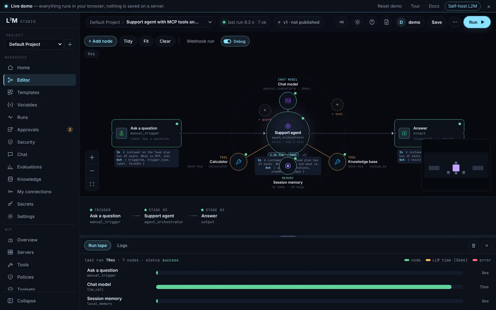

# L2M

**Put AI agents into production, on your own servers.**

L2M (lsquarem) is an open-source, self-hosted orchestrator for AI agents and workflows. Build them visually,
connect any MCP server, and control every tool call with approvals, budgets and replay tests.

[Live demo in your browser](https://lsquarem.com/demo/) · [Docs](https://lsquarem.com/docs/) ·
[5-minute tutorial](https://lsquarem.com/docs/getting-started/build-your-first-mcp-agent) ·
[Templates](https://lsquarem.com/docs/recipes/)

## Run it

You need Docker with Compose. Then:

    curl -fsSL https://lsquarem.com/install.sh | sh

Open http://localhost:8080 and sign in as `admin@l2m.local` with the password the installer prints.
Prefer not to pipe a script into a shell? Two commands do the same, in an empty folder:

    curl -fsSL https://raw.githubusercontent.com/TensorGreed/l2m/v0.1.0/docker-compose.quickstart.yml -o docker-compose.yml
    docker compose up -d

The generated password is printed once in `docker compose logs api`.

More (ports, keys, upgrades, Helm, Postgres): [Install with Docker](https://lsquarem.com/docs/getting-started/install).
To work on L2M itself you need Node.js 24+ and pnpm 10+: see [Run from source](https://lsquarem.com/docs/getting-started/run-from-source).

Docker (amd64/arm64), Helm, SQLite or Postgres. Nothing is hosted by us, and L2M does not phone home.

## What people use it for

- **One MCP gateway for your team.** Serve your MCP servers and workflows to any MCP client through one
  endpoint, with per-client tokens, allow/deny rules per tool and per-tool usage and cost.
- **A human approves before the agent writes.** Agents read freely, pause for approval before write tools,
  and stop at a budget.
- **CI for agents.** Record a run, change the prompt or model, replay, and block the release if the
  behaviour changes.

## What's inside

Visual builder with ~140 node types · describe-a-workflow builder · import workflow exports from other
visual builders · supervisor/worker agents · OpenAI-compatible AI gateway · RBAC, SSO, audit log ·
OpenTelemetry traces · VS Code extension. Full list in the [docs](https://lsquarem.com/docs/).

Pre-1.0 and moving fast. MIT licensed. Questions and ideas: [Discussions](https://github.com/TensorGreed/l2m/discussions).

## Learn MCP and AI agents

Free guides at [lsquarem.com/docs/learn](https://lsquarem.com/docs/learn/), useful whether or not you use L2M:

- [What is MCP?](https://lsquarem.com/docs/learn/mcp/what-is-mcp) and [What is an AI agent?](https://lsquarem.com/docs/learn/agents/what-is-an-ai-agent)
- [Prompt injection](https://lsquarem.com/docs/learn/security/prompt-injection) and [MCP security risks](https://lsquarem.com/docs/learn/security/mcp-security-risks)
- [Regression testing agents](https://lsquarem.com/docs/learn/testing/regression-testing-agents)
- [LLM gateway vs MCP gateway](https://lsquarem.com/docs/learn/operations/llm-gateway-vs-mcp-gateway)

Also the [Glossary](https://lsquarem.com/docs/glossary/), ready-to-import [Recipes](https://lsquarem.com/docs/recipes/)
and the [Blog](https://lsquarem.com/docs/blog/).

## Docs map

| I want to | Read |
| --- | --- |
| Install, sign in, run a first workflow | [Install with Docker](https://lsquarem.com/docs/getting-started/install), [Quickstart](https://lsquarem.com/docs/getting-started/quickstart) |
| Set up the repo, run the tests, build | [Run from source](https://lsquarem.com/docs/getting-started/run-from-source), [CI pipeline](https://lsquarem.com/docs/operations/ci) |
| Configure environment variables | [Environment](https://lsquarem.com/docs/getting-started/environment), [Postgres](https://lsquarem.com/docs/operations/postgres) |
| Understand the architecture and layout | [Architecture overview](https://lsquarem.com/docs/architecture/overview) |
| Know the workflow file format and samples | [Workflow JSON and samples](https://lsquarem.com/docs/architecture/workflow-json) |
| Call the HTTP API | [API endpoints](https://lsquarem.com/docs/api/endpoints) |
| Sign-in, roles and RBAC | [Auth and RBAC](https://lsquarem.com/docs/security/auth-rbac) |
| Secure and call webhooks (bearer, HMAC, Postman examples) | [Secure webhooks](https://lsquarem.com/docs/security/secure-webhooks) |
| Store credentials | [Secrets](https://lsquarem.com/docs/security/secrets) |
| Organize and debug workflows in the editor | [Workflow editor](https://lsquarem.com/docs/product/workflow-editor) |
| Triggers, integrations, chat models, Azure and Qdrant nodes | [Triggers and integrations](https://lsquarem.com/docs/nodes/triggers-and-integrations), [Node reference](https://lsquarem.com/docs/nodes/reference/) |
| Agent loop, ports, memory, tool cache, output limits | [Agent loop](https://lsquarem.com/docs/runtime/agent-loop) |
| Pass data between nodes | [Templates and expressions](https://lsquarem.com/docs/runtime/templates-and-expressions) |
| Connect an MCP server | [MCP integration](https://lsquarem.com/docs/extensions/mcp) |
| Render PDFs, parse model output | [Core nodes](https://lsquarem.com/docs/nodes/core-nodes) |
| Add a provider, connector or MCP adapter | [Providers](https://lsquarem.com/docs/extensions/providers), [Connectors](https://lsquarem.com/docs/extensions/connectors), [MCP](https://lsquarem.com/docs/extensions/mcp) |
| Ship a community node package | [Community nodes](https://lsquarem.com/docs/extensions/community-nodes), [l2m-nodes-template](https://github.com/TensorGreed/l2m-nodes-template) |
| Use the VS Code extension | [VS Code extension](https://lsquarem.com/docs/getting-started/vscode-extension) |
| Verify a release image | [Verify a release](https://lsquarem.com/docs/operations/verify-a-release) |

Reference projects (helpdesk agent, support triage, VS Code repo reviewer) are in
[l2m-samples](https://github.com/TensorGreed/l2m-samples).

## Repository layout

A pnpm and TypeScript monorepo.

- `apps/api`: Fastify API, SQLite or Postgres
- `apps/web`: React and React Flow studio
- `apps/docs`: the VitePress docs
- `apps/vscode-l2m-agent`: the VS Code extension
- `packages/`: `shared` (schemas and node definitions), `workflow-engine`, `agent-runtime`, `provider-sdk`, `mcp-sdk`, `connector-sdk`
- `samples/workflows`: sample workflows
- `docs/`: the lsquarem.com landing page

The full layout is in the [architecture overview](https://lsquarem.com/docs/architecture/overview).

## Contributing, security, license

L2M is MIT licensed and welcomes adapters, MCP integrations, docs, bug reports and real-world patterns. Start with
[CONTRIBUTING.md](CONTRIBUTING.md); participation is governed by the [Code of Conduct](CODE_OF_CONDUCT.md).

- Bug: file a [bug report](https://github.com/TensorGreed/l2m/issues/new?template=bug_report.yml).
- Question or design discussion: [GitHub Discussions](https://github.com/TensorGreed/l2m/discussions).
- Security issue: a [private advisory](https://github.com/TensorGreed/l2m/security/advisories/new); see [SECURITY.md](SECURITY.md).
- Changes: [CHANGELOG.md](CHANGELOG.md). Plans: [ROADMAP.md](ROADMAP.md).
- License: [MIT](LICENSE).
